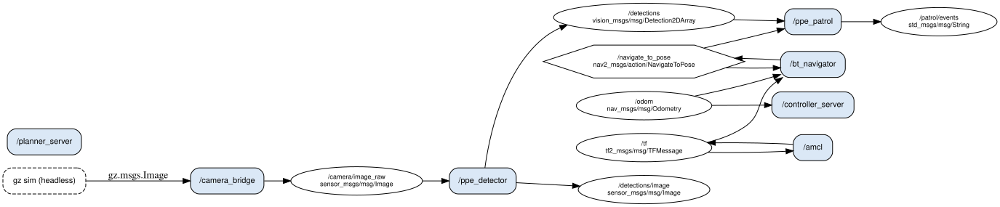
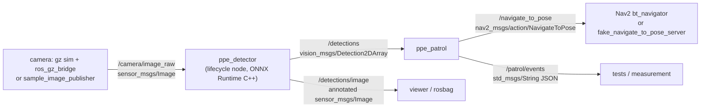

# ppe-ros2

A small ROS 2 Jazzy project: a C++ node runs a PPE (personal protective equipment) detector on a camera topic, and a second C++ node sends a Nav2 `NavigateToPose` goal to an inspection pose when a missing-PPE class is seen for several frames in a row.

Built by Zulfaqar Hafez with Claude Code as the coding agent. The detector model was trained earlier by Zulfaqar's course project team; this repository only runs it.

## What runs, and at which level

| Level | What | Status here |
|---|---|---|
| (a) Gazebo | Gazebo Harmonic, headless, TurtleBot3 Waffle with an RGB camera, Nav2 (AMCL on the `tb3_sandbox` map), the detector on the simulated camera, the patrol node sending a real `NavigateToPose` goal | **Reached.** One recorded run: the goal was accepted by Nav2's `bt_navigator`, the robot drove about 2.6 m and the goal succeeded ([results/gazebo_run.json](results/gazebo_run.json)). |
| (b) Replay | The five sample images replayed on the camera topic, the same two nodes, and a **fake** `NavigateToPose` server that stands in for Nav2 | Used for the integration tests, the parity test through ROS, the measurements and the Docker image. |

Two things about level (a) to know before reading anything into it:

- **The poster trick.** The model only recognises PPE in photographs, so the world has a flat, visual-only "poster" of one sample image (`plant-cctv`) in front of the robot. It has no collision shape and floats above the lidar plane, so the map and the lidar do not see it. The camera does.
- **Which class triggers in simulation.** On the original image the model finds `No-Helmet` 0.627 and `No-vest` 0.694. On the rendered poster, `No-Helmet` scores at most 0.39 (median 0.30) and `No-vest` about 0.67, so the Gazebo launch watches `No-Helmet,No-vest` instead of only `No-Helmet`. The goal in the recorded run was triggered by `No-vest` 0.673 for 3 frames.

It is one robot in a tiny world, CPU only, with no real hardware.

## Quick start

With Docker (replay level, tests and a 20 s demo):

```bash
docker build -t ppe-ros2 .
docker run --rm ppe-ros2          # colcon test, package.xml check, then the replay demo
```

The build downloads the model from the public site and checks its SHA-256. Behind a TLS-intercepting proxy, add `--secret id=extra_ca,src=/path/to/proxy-ca.crt` to `docker build`. `docker run --rm ppe-ros2 test` or `... demo` runs one part.

Natively on Ubuntu 24.04 with ROS 2 Jazzy (needed for the Gazebo level, which is not in the Docker image):

```bash
sudo apt install ros-jazzy-ros-base ros-jazzy-vision-msgs ros-jazzy-cv-bridge \
  ros-jazzy-onnxruntime-vendor ros-jazzy-nav2-msgs libopencv-dev python3-opencv \
  ros-jazzy-ament-lint-auto ros-jazzy-ament-lint-common ros-jazzy-ament-cmake-gtest \
  ros-jazzy-launch-testing-ament-cmake ros-jazzy-launch-testing-ros
# for level (a):
sudo apt install ros-jazzy-ros-gz ros-jazzy-navigation2 ros-jazzy-nav2-bringup \
  ros-jazzy-nav2-minimal-tb3-sim
source /opt/ros/jazzy/setup.bash
colcon build --cmake-args -DCMAKE_BUILD_TYPE=Release   # -DPPE_MODEL_FILE=/path/to/local/copy optional
source install/setup.bash
ros2 launch ppe_bringup replay_demo.launch.py images:=plant-cctv   # level (b)
ros2 launch ppe_bringup gazebo_demo.launch.py                      # level (a), headless
AMENT_CPPCHECK_ALLOW_SLOW_VERSIONS=1 colcon test && colcon test-result --verbose
```

## Architecture



The graph above is drawn from `ros2 node info` during the recorded Gazebo run ([docs/evidence/graph/](docs/evidence/graph/) has the raw node, topic and action lists).



Packages (`src/`):

- **ppe_detector** (C++17, `ament_cmake`, `rclcpp_lifecycle`). `ppe_core` is a C++ port of `ppeDetect.ts` and `scripts/ppe-samples.py` from the site: letterbox to 320 with grey 114 (rounding as `Math.round`), a resize that reproduces Pillow's bilinear filter and fixed-point arithmetic (the reference results were made with Pillow), planar RGB float tensor, decode of the `[1, 10, N]` output with clamping, then per-class NMS at IoU 0.7 with a stable sort. Class names come from the model: `Gloves, Helmet, No-Helmet, No-gloves, No-vest, Vest`. The node configures (loads the model) and activates (subscribes) through lifecycle transitions; the launch files drive them with launch events, and an `autostart` parameter exists for scripts. Parameters: `model_path`, `input_size`, `intra_op_threads` (0 = ONNX Runtime default), `score_threshold` (0.25, as the site demo starts), `candidate_floor` (0.05), `iou_threshold` (0.7), topic names, `publish_annotated`, `image_queue_depth` (1, keep only the newest frame), `image_reliability`. Outputs keep the image header, so stamps carry through. `ppe_detect_image` runs the same pipeline on still images without ROS.
- **ppe_patrol** (C++17). `PatrolLogic` (no ROS, unit tested) counts consecutive frames where a `violation_classes` entry scores at least `min_confidence`; at `consecutive_frames` (3) it sends one `NavigateToPose` goal to `goal_x`, `goal_y`, `goal_yaw` in `goal_frame`. While a goal runs, frames are not counted; after the result a `cooldown_s` starts, and a fresh run of N frames is needed. The action client checks the server is up before sending, logs feedback (distance remaining), reports the result code, waits `retry_after_reject_s` after a rejected goal (Nav2 still starting) and cancels a goal that runs past `goal_timeout_s`. Every step is published on `/patrol/events` as JSON with stamps.
- **ppe_bringup**: launch files, the replay publisher (`sample_image_publisher`, writes the sample id into `header.frame_id`), the fake `NavigateToPose` server (straight-line "drive" at 0.5 m/s with feedback, cancel and success; it is **not** Nav2), the five sample images as PNG with `samples.json`, and the launch tests. The Gazebo launch reuses `nav2_minimal_tb3_sim` and `nav2_bringup` from the ROS packages and edits them at launch time (adds the poster, swaps the depth camera for a 640 x 480 RGB camera pitched up 0.25 rad, gives AMCL the spawn pose); no upstream files are copied into this repository.

QoS: detections and patrol events are reliable (events also transient local). The image subscription keeps the newest frame only and is reliable by default; with best effort, most 0.7 to 1.2 MB frames were lost between processes on this machine (0.87 of 5 offered frames per second processed, see below), so best effort is a parameter, not the default.

## Measured results

All from [scripts/measure.py](scripts/measure.py) and [scripts/gazebo_run.py](scripts/gazebo_run.py) on this machine, written to [results/](results/). Machine: Intel Xeon Processor @ 2.10GHz, 4 logical CPUs (1 thread per core), 15.7 GiB RAM, no GPU used, Ubuntu 24.04.5, ROS 2 Jazzy, ONNX Runtime 1.24.3 (CPU execution provider).

Detector node, fed the five sample images in a loop ([results/benchmark.md](results/benchmark.md)), 30 s windows:

| intra-op threads | offered fps | processed fps | latency p50 / p95 ms | inference p50 / p95 ms | CPU, % of one core |
|---|---|---|---|---|---|
| 1 | 50 | 24.3 | 47.5 / 64.8 | 31.9 / 46.8 | 100.4 |
| 1 | 5 | 5.0 | 52.9 / 72.1 | 37.2 / 52.1 | 21.4 |
| default | 50 | 31.6 | 41.2 / 52.0 | 24.4 / 32.7 | 386.8 |
| default | 5 | 5.0 | 48.5 / 58.1 | 33.2 / 41.3 | 102.4 |

Latency is from the image header stamp (set just before publishing) to the measuring script receiving the `Detection2DArray`, so it includes two DDS hops and a Python callback. At 50 offered fps the node is saturated, so processed fps is its throughput. At 5 fps the default thread setting used about one full core against 21 percent for one thread, for a few milliseconds less inference; that is consistent with ONNX Runtime's thread pool spinning between frames, which was not investigated further.

Detection to goal, replay level with the fake server, plant-cctv at 5 fps, 60 s: 38 goals sent, 38 succeeded. From the frame that completed the run of 3 to the goal being sent: p50 47.6 ms, p95 58.3 ms. From the first frame of the run: p50 447.8 ms, p95 458.4 ms (this includes waiting for 3 frames at 5 fps).

Gazebo run ([results/gazebo_run.json](results/gazebo_run.json)):

- real-time factor (simulated seconds over Gazebo's real seconds): 0.975 over 20 s while Nav2 drove, 0.982 over 10 s after the goal;
- detector on the simulated 5 Hz camera: 4.86 frames/s processed, inference p50 46.7 ms, p95 81.6 ms (heavier than above because Gazebo rendering on the CPU and Nav2 share the 4 cores);
- the patrol node's first goal was rejected because Nav2 was still activating; it retried 2 s later; the goal took 9.8 s of simulated time (10.1 s wall) to succeed; 19 s wall from launch to the result. The trigger image to goal sent took 0.072 s of simulated time.

## Parity with the site

`test_parity` (gtest) runs the C++ pipeline on the five PNG samples and compares with `samples.json`, which the site's reference script produced with Pillow and Python ONNX Runtime. Rule: the same labels at thresholds 0.25 and 0.5, each score within 0.001 (samples.json rounds scores to 3 decimals). Result: all 26 expected detections match; worst score difference 0.0005, which is the rounding in samples.json. `test_node_parity` (launch test) checks the same through ROS, comparing the node's `Detection2DArray` for each replayed image: worst difference also 0.0005. Boxes are not compared because samples.json does not store them.

## Tests and lint

`colcon test`: 92 results, 0 failures, on this machine and in the Docker image. They are:

- gtest: `test_ppe_core` (letterbox and rounding, Pillow-style resize checked against hand-computed values, tensor layout and padding, decode and clamping, NMS), `test_parity`, `test_patrol_logic` (streaks, breaks, confidence, no second goal while active or cooling down, retry after reject);
- launch_testing: `test_violation_sends_goal` (publisher, detector, patrol and fake server: a goal is sent after 3 frames of plant-cctv, accepted, gets feedback and succeeds), `test_compliant_no_goal` (20 frames of site-backs, where the model finds only Vest and Helmet: no goal), `test_node_parity`;
- lint: cpplint, uncrustify, cppcheck, lint_cmake, flake8, pep257.

Lint exceptions:

- `ament_copyright` is off and cpplint runs with `-legal/copyright`: there is no licence yet, so files carry no copyright header.
- `ament_xmllint` is off: libxml2 on Ubuntu 24.04 does not fetch the package.xml schema over http here. `scripts/check_package_xml.sh` fetches it with curl and validates all three `package.xml` files (run by the Docker `test` command).
- cppcheck 2.13 on Ubuntu 24.04 is skipped by ament unless `AMENT_CPPCHECK_ALLOW_SLOW_VERSIONS=1` is set; the Docker image sets it.

CI: [.github/workflows/ci.yml](.github/workflows/ci.yml) builds the Docker image, runs `colcon test` in it and a 20 s replay demo that must log `goal succeeded`. Its steps were run locally; the workflow has not run on GitHub yet.

## Evidence

- [docs/evidence/gazebo/rosbag/](docs/evidence/gazebo/rosbag/): rosbag2 (mcap, 1.2 MB, no images) of the Gazebo run: detections, patrol events, detector timing, odometry, plan, AMCL pose, `navigate_to_pose` status and feedback.
- [docs/evidence/gazebo/run.log](docs/evidence/gazebo/run.log): the launch output of that run. The errors at the end are Nav2's lifecycle managers noticing the shutdown.
- [docs/evidence/gazebo/frames/](docs/evidence/gazebo/frames/) and [camera_clip.mp4](docs/evidence/gazebo/camera_clip.mp4): annotated frames from the simulated camera, 1.5 s apart: the poster with the `No-vest` box at the start, the drive, and the view back at the poster from the inspection pose (goal yaw 180 degrees).
- [docs/evidence/graph/](docs/evidence/graph/): node graph (SVG and DOT) and `ros2 node/topic/action` dumps.
- [docs/evidence/replay/](docs/evidence/replay/): the five samples annotated by the C++ detector, their detections as JSON lines, and a log of the replay demo.

To regenerate: `python3 scripts/measure.py`, `python3 scripts/gazebo_run.py`, `scripts/replay_evidence.sh` (workspace built and sourced).

## Limits

- CPU only; numbers are for this 4-vCPU machine and will differ elsewhere.
- Level (a) is one robot in Nav2's tiny TurtleBot3 sandbox, with a photo poster as the only thing the model can recognise, and one recorded run. In simulation the trigger was `No-vest`, not `No-Helmet` (see above).
- Level (b) replays five still images; its action server is a fake, not Nav2.
- No real robot, camera or hardware was used.
- The model is the site's int8, 320 px export (mAP50 0.41 on the held-out test split per the site's evaluation, against 0.47 for the full model at 640 px). It misses many items; the five samples include a known failure (packing-cctv, where it finds 0 of 12 labelled items).
- Detection only: no tracking across frames beyond counting consecutive frames, no depth, no localisation of the person on the map; the inspection pose is a fixed parameter.

## Model, data and licence

The model is a YOLOv8s detector trained by teammates in a university course project with Ultralytics YOLOv8 (AGPL-3.0), exported to ONNX at 320 px with dynamic int8 quantisation. The training data and the five sample images come from the Roboflow Universe dataset "Personal Protective Equipment" v5 (workspace maxis), licence CC BY 4.0. See [NOTICE](NOTICE). The model file is not in this repository; the build fetches it from https://zulfaqarhafez.com/models/ppe/ppe_yolov8s_320_int8dyn.onnx and checks SHA-256 `d0a6c62f4bda6733f443b22bf9dce288b8f082ca0fc2f404a4931eb7cf0cbac2`.

No licence file has been added to this repository yet (owner decision), so no licence is granted for the code.
