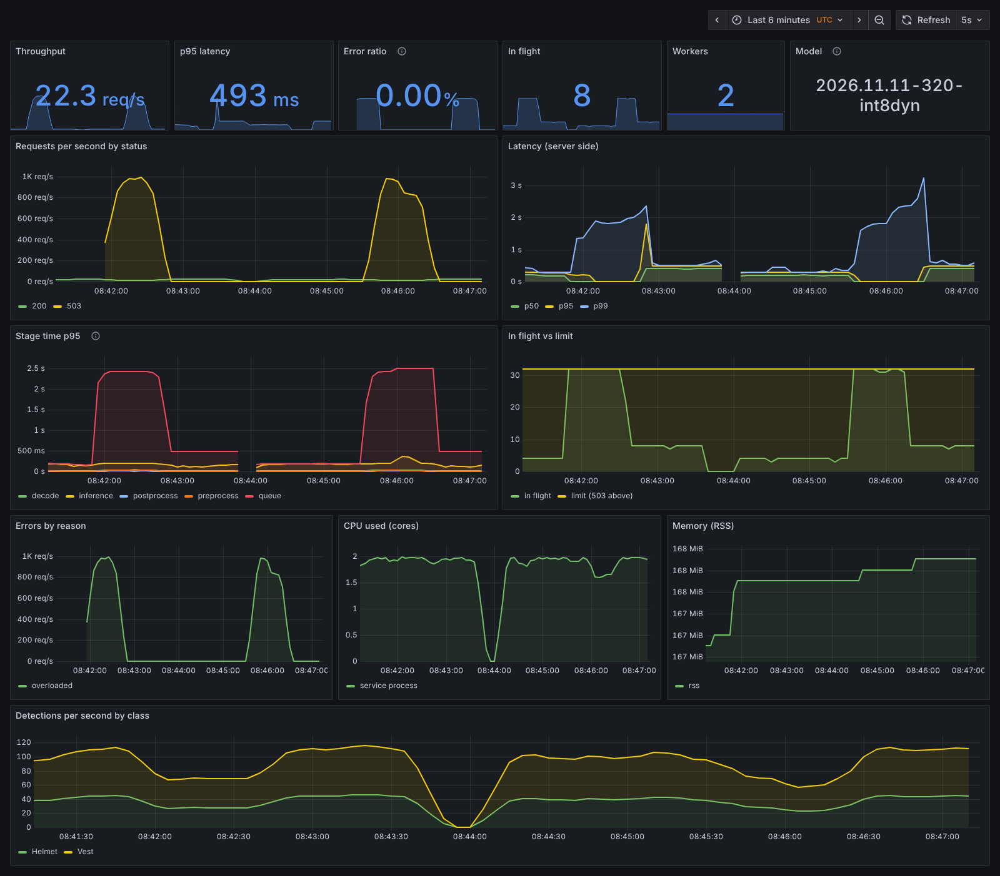

# PPE detection service

A small, measured production wrapper around one model: the PPE detector from a
university course project (YOLOv8s, exported to ONNX at 320 px with dynamic
int8 weights), the same file the in-browser demo on
[zulfaqarhafez.com](https://zulfaqarhafez.com/work/ppe-compliance) runs. It is a
FastAPI and ONNX Runtime HTTP service with a checksum-verified model registry
step, a Docker image, Prometheus metrics and a Grafana dashboard, a k6 load
test, Kubernetes manifests run on a local kind cluster, and a CI workflow.

Built by Zulfaqar Hafez with Claude Code as the coding agent. Every number on
this page comes from a file under [`results/`](results/) that a committed
script produced on the machine described below.



*The provisioned dashboard while `scripts/dashboard_under_load.sh` drove load at
the compose stack: 4 users, then 48 users (above the in-flight cap of 32, so
the 503 path shows), then 8 users ([`results/dashboard_load.jsonl`](results/dashboard_load.jsonl)).*

## What is here

| Part | Where |
|---|---|
| Service: `POST /v1/detect`, `/healthz`, `/readyz`, `/metrics` | [`src/ppe_service/`](src/ppe_service/) |
| Model registry step: manifest and fetch script | [`registry/manifest.json`](registry/manifest.json), [`scripts/fetch_model.py`](scripts/fetch_model.py) |
| Tests: unit, API, registry, entry point, parity | [`tests/`](tests/) |
| Image and local stack (service, Prometheus, Grafana) | [`Dockerfile`](Dockerfile), [`compose.yaml`](compose.yaml), [`monitoring/`](monitoring/) |
| Load test and runners | [`loadtest/detect.js`](loadtest/detect.js), [`scripts/loadtest.sh`](scripts/loadtest.sh), [`scripts/shutdown_test.py`](scripts/shutdown_test.py) |
| Kubernetes: kustomize base, kind overlay, kind scripts | [`k8s/`](k8s/), [`scripts/kind_up.sh`](scripts/kind_up.sh), [`scripts/kind_hpa.py`](scripts/kind_hpa.py) |
| CI | [`../.github/workflows/service.yml`](../.github/workflows/service.yml), [`scripts/ci.sh`](scripts/ci.sh), [`scripts/ci_local.sh`](scripts/ci_local.sh) |
| Operations | [`docs/RUNBOOK.md`](docs/RUNBOOK.md) |

## Architecture

```
 client ── multipart image ──▶ uvicorn (uvloop, httptools), one process
                                │  ASGI middleware: request id, JSON access log,
                                │  request metrics, early Content-Length check
                                ▼
                              FastAPI /v1/detect
                                │  admission: in-flight cap ─▶ 503 when full
                                │  per-request timeout      ─▶ 504
                                ▼
                              worker pool: N threads (default one per CPU of the
                              container's limit, read from the cgroup quota)
                                │  each request on one thread, end to end:
                                │  validate (format, bytes, pixels) ─▶ 400/413/415
                                │  letterbox to 320 (Pillow bilinear, grey 114)
                                │  ONNX Runtime CPU, 1 intra-op thread, shared session
                                │  decode + per-class NMS (IoU 0.7)
                                ▼
                              JSON: boxes, labels, scores, model version and
                              SHA-256, timing per stage (queue, decode,
                              preprocess, inference, postprocess, total)

 Prometheus ── scrapes /metrics every 5 s ──▶ Grafana (provisioned dashboard)
 Kubernetes: Deployment ─ Service ─ HPA (CPU) ─ PDB ─ ConfigMap (PPE_* settings)
```

The model file is never committed. It is fetched by URL and refused unless its
SHA-256 matches the manifest, three times over: when the Docker build downloads
it, on the file that ships in the image, and when the server starts (exit code
3 on a mismatch, so the container never becomes ready).

Pre- and post-processing are a port of the site's
`src/components/demos/ppeDetect.ts`: JavaScript `Math.round` letterbox
arithmetic, Pillow's bilinear resize (which made the site's reference results),
planar RGB scaled 0 to 1, best class per candidate with ties to the first class,
boxes mapped back and clamped, then a stable score sort and per-class NMS at
IoU 0.7. The default score threshold is the site's 0.25.

## Quick start

```bash
docker compose up -d --build
curl -F file=@tests/data/samples/plant-cctv.webp http://127.0.0.1:8000/v1/detect
```

Grafana is at http://127.0.0.1:3000 (dashboard "PPE service", anonymous
read-only), Prometheus at http://127.0.0.1:9090. `docker compose down` stops it.
Behind a TLS-intercepting proxy, build the image first with the proxy's CA as a
BuildKit secret, which is mounted only while downloading and never stored in a
layer: `docker build --secret id=extra_ca,src=/path/to/ca.crt -t ppe-service:dev .`

Without Docker: `uv sync --frozen`, `uv run python scripts/fetch_model.py`,
then `PYTHONPATH=src uv run python -m ppe_service`.

## API

| Endpoint | Purpose |
|---|---|
| `POST /v1/detect` | Multipart field `file` (JPEG, PNG or WebP); optional `?threshold=` 0 to 1. Returns `detections` (label, class id, score, `missing_item` for the "No-" classes, box in image pixels), `model` (name, version, sha256, input size), `image` size and `timing_ms`. Echoes or creates `X-Request-ID`. |
| `GET /healthz` | Liveness: the process answers. |
| `GET /readyz` | Readiness: model loaded and not draining; 503 otherwise. |
| `GET /metrics` | Prometheus: `ppe_http_requests_total`, `ppe_http_request_duration_seconds` (histogram), `ppe_stage_duration_seconds{stage}` (histogram), `ppe_in_flight_requests`, `ppe_in_flight_limit`, `ppe_errors_total{reason}`, `ppe_model_info`, `ppe_inference_workers`, `ppe_detections_total{label}`, `ppe_ready`, process CPU and memory. |

Errors are JSON `{"error", "detail", "request_id"}`: 400 empty or undecodable,
413 upload or pixel count over the limit, 415 not JPEG, PNG or WebP, 422 bad
parameters, 503 in-flight cap reached or draining, 504 timeout.

Settings (environment variables):

| Variable | Default | Meaning |
|---|---|---|
| `PPE_WORKERS` | `0` | Inference threads; 0 means one per CPU of the container's limit |
| `PPE_INTRA_OP_THREADS` | `1` | ONNX Runtime threads per inference |
| `PPE_MAX_IN_FLIGHT` | `32` | Requests admitted at once (queued plus running) |
| `PPE_REQUEST_TIMEOUT_S` | `10` | Per-request deadline |
| `PPE_MAX_UPLOAD_BYTES` | `8388608` | Upload limit |
| `PPE_MAX_PIXELS` | `25000000` | Pixel limit, checked from the header before decoding |
| `PPE_ALLOWED_FORMATS` | `JPEG,PNG,WEBP` | Accepted formats |
| `PPE_SCORE_THRESHOLD`, `PPE_IOU_THRESHOLD` | `0.25`, `0.7` | Decode defaults |
| `PPE_MODEL_PATH`, `PPE_MANIFEST_PATH`, `PPE_MODEL_SHA256` | image paths, manifest hash | Model location and pinned hash |
| `PPE_GRACEFUL_TIMEOUT_S` | `25` | How long shutdown waits for open requests |
| `PPE_HOST`, `PPE_PORT`, `PPE_LOG_LEVEL` | `0.0.0.0`, `8000`, `INFO` | Server |

Logs are one JSON object per line, each request line carrying its request id,
route, status and duration.

## Model registry step

[`registry/manifest.json`](registry/manifest.json) names the model
(`ppe-yolov8s`, version `2026.11.11-320-int8dyn`), pins its SHA-256 and size,
gives its source URL, lineage (checkpoint, Ultralytics version, export and
quantisation), licences, input and output layout, and the held-out metrics
copied from the course repository's eval file: file
`eval/results/onnx_export.json`, key `variants.int8dyn_320`, commit `77a260a1`
of [aai3001_deep_learning](https://github.com/ZulfaqarHafez/aai3001_deep_learning)
(`test_map50` 0.4135).

`scripts/fetch_model.py` takes a local path, a `file://` URL or an `http(s)://`
URL (default: the manifest's public URL), writes to a temporary file, and only
moves it into place if the SHA-256 and size match; a mismatch exits 1 and
leaves nothing behind. `--verify-only FILE` checks a file in place.

The model is published only at its public URL today. To move it to a model hub
or an object store later, upload the same file and pass its HTTPS location; the
pinned hash stays the check:

```bash
# Hugging Face Hub (pin a commit, not a branch)
python scripts/fetch_model.py --source \
  https://huggingface.co/<owner>/<repo>/resolve/<commit-sha>/ppe_yolov8s_320_int8dyn.onnx
# S3 (public object or a presigned URL); GCS works the same way
python scripts/fetch_model.py --source \
  https://<bucket>.s3.<region>.amazonaws.com/ppe/2026.11.11-320-int8dyn/ppe_yolov8s_320_int8dyn.onnx
python scripts/fetch_model.py --source \
  https://storage.googleapis.com/<bucket>/ppe/2026.11.11-320-int8dyn/ppe_yolov8s_320_int8dyn.onnx
```

Then set `artifact.source` in the manifest (or `--build-arg MODEL_SOURCE=...`
for the image). `hf://` and `s3://` schemes are not implemented; private
buckets would need presigned URLs or an SDK.

## Measured results

**Machine** ([`results/loadtest/machine.json`](results/loadtest/machine.json)):
Intel Xeon Processor @ 2.10GHz, 4 logical CPUs, 15.7 GiB RAM, kernel
6.18.44, no GPU, Docker 29.9.2, k6 1.0.0. A virtual machine; the load generator
runs on the same host as the service, outside the container's CPU limit.

### Throughput and latency

k6 closed loop, one 640 x 486 WebP sample per request, 15 s per level after a
warm-up, keep-alive on ([`results/loadtest/summary.md`](results/loadtest/summary.md),
from `scripts/loadtest.sh`). No request failed in any of these runs.

2-CPU limit, default layout (2 workers x 1 thread):

| Users | req/s | p50 ms | p95 ms | p99 ms |
|---:|---:|---:|---:|---:|
| 1 | 11.8 | 81 | 105 | 113 |
| 2 | 21.6 | 87 | 122 | 144 |
| 4 | 24.0 | 158 | 207 | 220 |
| 8 | 24.3 | 317 | 412 | 500 |
| 16 | 25.5 | 617 | 693 | 774 |
| 32 | 24.8 | 1263 | 1422 | 1499 |

1-CPU limit, default layout (1 worker x 1 thread):

| Users | req/s | p50 ms | p95 ms | p99 ms |
|---:|---:|---:|---:|---:|
| 1 | 10.0 | 98 | 125 | 192 |
| 2 | 10.9 | 169 | 242 | 338 |
| 4 | 11.6 | 332 | 397 | 537 |
| 8 | 11.3 | 675 | 838 | 1034 |
| 16 | 11.4 | 1338 | 1636 | 1664 |
| 32 | 10.8 | 2907 | 3336 | 3399 |

**Saturation point** (the first level where doubling the users adds under 10%
throughput but over 50% p95): 4 users at about 24 req/s under 2 CPUs, and 1
user at about 10 req/s under 1 CPU. Past it, extra users only queue: at 32
users under 2 CPUs p95 is 1.4 s for the same throughput.

**Worker layout under 2 CPUs.** Two single-threaded workers peaked at 25.54
req/s; one worker with two ONNX Runtime threads peaked at 17.70 req/s, so the
default (one single-threaded worker per CPU) gives 44.3% more throughput. The
two-thread worker does answer a lone user faster (p50 57 ms against 81 ms), so
it would suit a latency-first, low-traffic deployment.

**Overload.** With 48 closed-loop users against a cap of 32 in flight (2
CPUs), the service shed the excess with immediate 503s: 98.5% of 41,641
requests, because each rejected user retried at once. It still answered 608
requests with 200 in those 45 s, 13.5 per second against 20.1 at 4 users, so
turning away about 880 requests a second took a real share of the CPUs. Clients
should back off on 503
([`results/dashboard_load.jsonl`](results/dashboard_load.jsonl)).

**Graceful shutdown under load** ([`results/shutdown.json`](results/shutdown.json),
`scripts/shutdown_test.py`): 16 clients posting continuously, then `docker stop`
(SIGTERM). All 16 requests in flight at the signal were drained and answered
200 and none were dropped; requests sent after the signal were turned away
(refused, or closed by Docker's port proxy), and the container exited 0 after
1.22 s.

**Image** ([`results/ci_local.log`](results/ci_local.log)): 469,146,136 bytes
uncompressed (Python 3.13 slim, ONNX Runtime, NumPy, Pillow, the 11.4 MB
model); runs as uid 10001, works with a read-only root filesystem, and the
Docker healthcheck reports healthy.

### Kubernetes on kind

One kind node (Kubernetes 1.33.1) on the same machine; pod requests 500m CPU and
256 MiB, limits 1 CPU and 512 MiB.

- Rollout of the kind overlay: 5 s to ready; a rolling update
  (`kubectl rollout restart`, maxUnavailable 0, maxSurge 1) of 2 replicas: 6 s;
  rollback with `kubectl rollout undo`: 6 s
  ([`results/k8s/rollout.txt`](results/k8s/rollout.txt)).
- In-cluster smoke request from a pod to `ppe-service.ppe.svc.cluster.local`:
  200, the expected detections, 176.3 ms round trip
  ([`results/k8s/smoke.json`](results/k8s/smoke.json)).
- HPA under k6 load (8 users, 150 s, through the NodePort and kube-proxy;
  [`results/k8s/hpa.md`](results/k8s/hpa.md)):

| Load generator | req/s | p95 ms | Replicas reached | Busiest pod's share | Requests per pod |
|---|---:|---:|---:|---:|---|
| keep-alive on | 12.2 | 743 | 4 | 100.0% | 1832, 0, 0, 0 |
| keep-alive off | 30.2 | 659 | 4 | 31.6% | 1435, 1136, 1133, 842 |

The keep-alive finding: the HPA scaled out to 4 pods in both runs, but with
keep-alive one pod served every request, because kube-proxy balances
connections, not requests, and k6 opened its connections while there was one
pod. With a new connection per request the same 4 pods shared the load and
throughput rose from 12.2 to 30.2 req/s. In production the fix is a request-level balancer
(an L7 ingress or a service mesh), clients that recycle connections, or a
server-side cap on requests per connection.

### Parity with the site

[`results/parity.json`](results/parity.json) (`scripts/parity_report.py`, also
`tests/test_parity.py`): on the site's five sample images at thresholds 0.25
and 0.5 (10 cases, 26 detections), the service returns the same labels in the
same order as `samples.json`, and the largest score gap is 0.000492 against a
stated tolerance of 0.001 (`samples.json` rounds scores to 3 decimals, so
0.0005 is rounding alone). ONNX Runtime 1.31.1, the version the course eval used.

### CI

[`.github/workflows/service.yml`](../.github/workflows/service.yml) runs on
changes under `service/`: ruff, `mypy --strict`, lock-file sync, the tests with
the real model (68), image build, container smoke test (detections, model hash,
healthcheck, non-root, exit 3 on a wrong hash), a k6 gate (p95 under 1000 ms and
errors under 1% at 2 users for 20 s), kubeconform on the kustomize output and
actionlint. A release job pushes to GHCR only on a `v*` tag and only when the
repository variable `PUBLISH_IMAGE` is `'true'`; it has not run. Actions are
pinned to commit SHAs and downloaded tools to SHA-256 hashes. Each step is a
`scripts/ci.sh` subcommand; `scripts/ci_local.sh` ran all of them on this
machine ([`results/ci_local.log`](results/ci_local.log)); the gate there measured
p95 120 ms at 21.3 req/s. The workflow itself has not run on GitHub yet.

## Model card summary

- **Model:** YOLOv8s, 6 classes (Gloves, Helmet, No-Helmet, No-gloves, No-vest,
  Vest), checkpoint `best_deep.pt`, trained by teammates in a university course
  project with Ultralytics YOLOv8 (AGPL-3.0). Exported to ONNX (opset 12) at
  320 px, then dynamic int8 quantisation; 11,366,765 bytes.
- **Data:** Roboflow Universe "Personal Protective Equipment" v5 (CC BY 4.0).
- **Accuracy (from the course repository, not re-measured here):** held-out
  test split of 255 images and 1,237 boxes: mAP50 0.4135, mAP50-95 0.1867,
  precision 0.548, recall 0.491 (`eval/results/onnx_export.json`, key
  `variants.int8dyn_320`).
- **Known weaknesses:** the course eval found the deployed checkpoint weakest on
  the "No-" classes, the ones a compliance alert would rely on; on the site's
  sample "packing-cctv" it finds none of 12 labelled items. Treat outputs as
  assistive, not as a safety decision.

## Limits

- CPU only, one process per container, measured on one 4-vCPU virtual machine.
- Single node: the Kubernetes results come from one kind node on the same
  machine, not a multi-node cluster.
- Synthetic load from the same host: k6 shares the machine with the service, one
  image size, closed-loop users; real traffic would differ.
- No authentication, no TLS, no rate limiting per client. Put it behind a
  gateway before exposing it.
- Not deployed publicly; no image has been published.
- Accuracy figures come from the course repository's eval and were not
  re-measured by this project.
- EXIF orientation is not applied, matching the reference pipeline; rotated
  phone photos are processed as stored.
- A request that times out (504) still finishes on its worker; its slot in the
  in-flight cap is released only then.

## Reproduce

```bash
uv sync --frozen && uv run python scripts/fetch_model.py
PPE_REQUIRE_MODEL=1 uv run pytest -q
docker build -t ppe-service:dev .              # add --secret id=extra_ca,... behind a proxy
scripts/loadtest.sh                            # results/loadtest/
uv run python scripts/shutdown_test.py         # results/shutdown.json
uv run python scripts/parity_report.py         # results/parity.json
docker compose up -d && scripts/dashboard_under_load.sh && docker compose down
scripts/kind_up.sh && python3 scripts/kind_hpa.py && scripts/kind_down.sh   # results/k8s/
scripts/ci_local.sh                            # results/ci_local.log
```

Needs Docker, uv, k6, kind, kubectl and Node with Playwright for the screenshot.

### Sandbox-specific workarounds (committed, marked in the files)

The machine this was built on runs Docker without `CAP_SYS_RESOURCE` behind a
TLS-intercepting proxy. With the stock kind node image, cluster creation failed
and the kubelet logged `write /proc/self/oom_score_adj: permission denied`
([`results/k8s/stock-node-check.txt`](results/k8s/stock-node-check.txt)). The
fixes, none needed on a normal host: a derived node image whose `runc` clamps
negative `oomScoreAdj` to 0 ([`k8s/kind/node/`](k8s/kind/node/)); creating the
cluster without the host's proxy variables and loading images with
`kind load image-archive` (saved for one platform); and
`--enable-aggregator-routing` on the API server so it reaches metrics-server.

## Licence and credits

See [NOTICE](NOTICE). No licence has been chosen for this code yet, so none is
granted.
